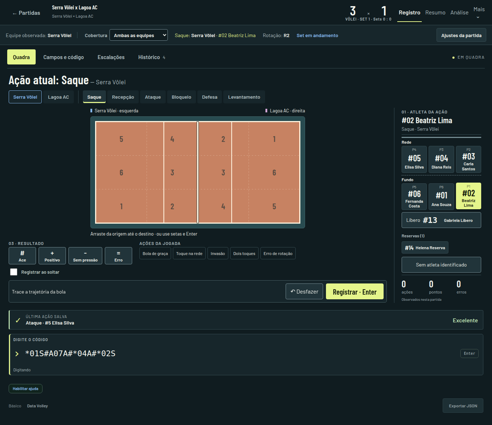
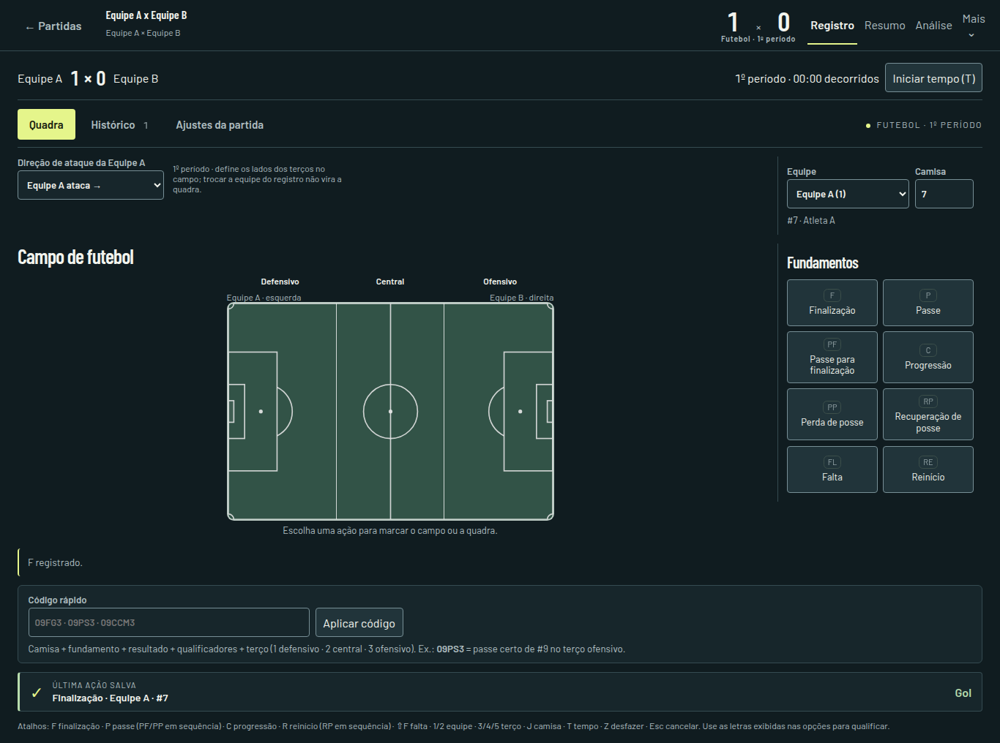
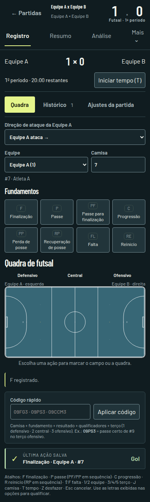
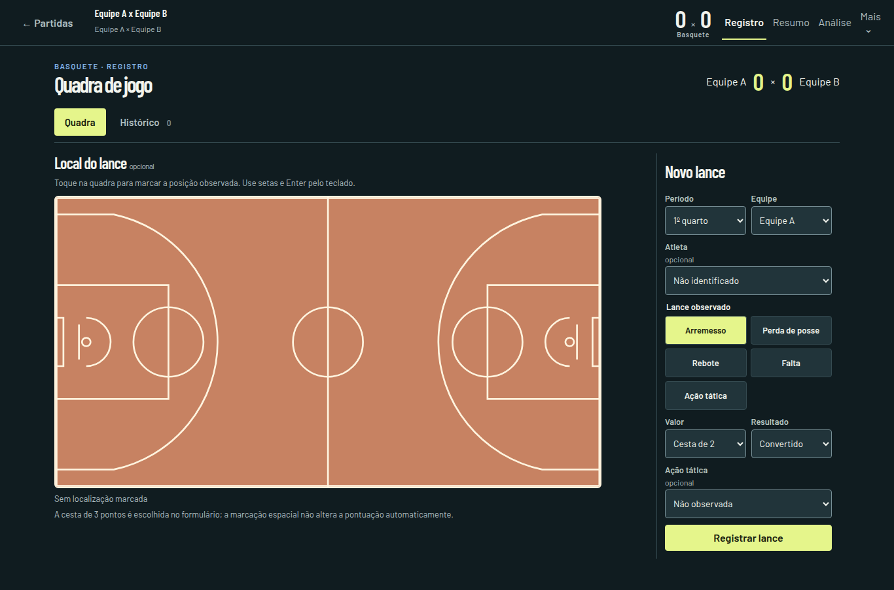
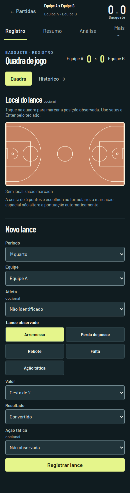

# Scout Trainer · Guia visual

Diretriz para vôlei, futebol, futsal, basquete e próximas expansões. Revisão: 8 de outubro de 2026.

## Ideia central

**Uma quadra interativa com interface.** A superfície de jogo é o centro do registro. O operador deve reconhecer a equipe, escolher o atleta e a ação, marcar o que observou e receber confirmação. Configurações e consultas não devem disputar atenção com esse ciclo.

A identidade é esportiva e sóbria: fundo azul-petróleo, tipografia condensada nos títulos e placares, quadra com linhas claras e uma cor de destaque reservada à seleção e à confirmação. Evitar cartões dentro de cartões, gradientes decorativos, excesso de bordas e animações contínuas.

## Fontes de verdade no código

| Responsabilidade | Arquivo |
|---|---|
| Cores, fontes, espaçamento e dimensões | `src/ui/styles/tokens.css` |
| Linguagem compartilhada entre modalidades | `src/ui/styles/sport-workbench.css` |
| Composição específica do vôlei | `src/ui/screens/scout/VolleyballUnifiedScout.css` |
| Registro essencial de futebol e futsal | `src/ui/screens/scout/EssentialScoutScreen.tsx` |
| Diálogo de ajustes, foco e Escape | `src/ui/components/ToolDialog.tsx` |
| Seis zonas, orientação e marcações do vôlei | `src/ui/components/VolleyballCourtZones.tsx` e `volleyballCourtGeometry.ts` |
| Captura por mouse, toque e teclado | `src/ui/screens/scout/GestureCourtInput.tsx` |

Usar os tokens e componentes existentes antes de acrescentar uma nova variação. Não criar outra paleta por tela. Regras específicas do esporte devem ficar no seu componente; cor, tipografia, foco e feedback pertencem à camada compartilhada.

## Tipografia

As fontes são **locais**, com licença OFL em `public/fonts/`. Não depender de Google Fonts durante a partida. O build inclui as fontes e a PWA as armazena para uso offline.

| Papel | Família | Tamanho de referência | Peso |
|---|---|---|---|
| Título de tela/ação | Barlow Condensed | 28–36 px no desktop; 24–28 px no celular | 600 |
| Placar | Barlow Condensed | 32–40 px | 600, números tabulares |
| Camisa/indicador numérico | Barlow Condensed | 22–28 px | 600 |
| Texto e controles | Barlow | 14–16 px | 400/600 |
| Legenda e contexto | Barlow | 12–13 px | 400/600 |
| Rótulo auxiliar curto | Barlow | 11–12 px | 600 |
| Código digitado | Monoespaçada | 18–22 px | regular |

Não usar letras maiúsculas em textos longos. Reservar caixa alta e espaçamento entre letras a rótulos curtos. Nunca substituir o nome do atleta apenas por um número ou uma cor. Fonte condensada serve à hierarquia, não a parágrafos ou formulários inteiros.

## Paleta e significado (Slate Precision)

| Token | Cor | Uso |
|---|---|---|
| `--st-bg` | `#0B0F19` | Fundo principal da aplicação (Deep Slate, reduz fadiga visual) |
| `--st-surface` | `#111827` | Containers e cards de apoio (Slate Container) |
| `--st-surface-raised` | `#1E293B` | Controles elevados, headers e inputs (Slate Elevated) |
| `--st-border` | `#334155` | Linhas de divisão ultrafinas de 1px |
| `--st-text` | `#F8FAFC` | Texto principal e métricas com números tabulares (`tnum`) |
| `--st-muted` | `#94A3B8` | Contexto secundário legível e legendas |
| `--st-accent` | `#3B82F6` | Seleção ativa e ação principal (Cobalto Analítico) |
| `--st-accent-text` | `#FFFFFF` | Texto com contraste cirúrgico sobre destaque |
| `--st-success` | `#10B981` | Taxas positivas, kill rate alto, saque ace (Menta Cirúrgico) |
| `--st-warning` | `#F59E0B` | Bolas de continuidade, taxas médias (Âmbar Técnico) |
| `--st-danger` | `#F43F5E` | Erros não forçados, bloqueios sofridos (Coral Carmesim) |
| `--st-team-a` / `--st-team-b` | `#60A5FA` / `#C084FC` | Identidade visual das equipes |
| `--st-court` | `#1E293B` | Superfície esportiva escura com alto contraste |
| `--st-court-line` | `#475569` | Linhas esportivas vetoriais nítidas |
| `--st-court-surround` | `#0B0F19` | Área externa da quadra |
| `--st-football-pitch` | `#064E3B` | Campo de futebol |
| `--st-futsal-court` | `#0E7490` | Quadra de futsal |

A seleção exige texto claro `#FFFFFF` sobre o Cobalto Analítico `#3B82F6`. Resultado, erro, equipe e seleção devem ser reconhecíveis por texto/forma além da cor. Todos os números de estatísticas (taxas, kills, volumes, probabilidades) devem usar `font-variant-numeric: tabular-nums` para alinhamento uniforme.

## Dimensões e ritmo

| Elemento | Regra |
|---|---|
| Área de trabalho | Até 1440 px, centralizada |
| Margem lateral | `clamp(12px, 2vw, 24px)` |
| Painel lateral | 280 px de referência; 240–248 px em composições mais compactas |
| Espaçamento | Escala de 4, 8, 12, 16, 24, 32 e 48 px |
| Raio dos controles | 4 px |
| Raio das superfícies | 6 px |
| Controle principal/toque | Pelo menos 44 px de altura |
| Comando secundário compacto | 34–40 px no desktop; ampliar quando usado por toque |
| Altura de quadra disponível | `--st-court-height`, ajustada pela altura da janela |
| Texto auxiliar | Não reduzir para fazer uma composição caber; reorganizar o layout |

A largura deve se adaptar à **proporção da superfície**, nunca deformar sua geometria para preencher uma coluna. Uma janela baixa pode reduzir a quadra; se os controles deixarem de ser legíveis, permitir rolagem vertical. Não sobrepor botões ao campo para forçar tudo na primeira tela.

### Composição responsiva

- **Desktop:** quadra na área principal; atleta, fundamentos ou resultado no painel lateral conforme a modalidade. Contexto e ações principais acima ou imediatamente ao lado da superfície.
- **Tablet:** duas colunas quando houver espaço real. Limitar a largura do painel, preservar `minmax(0, 1fr)` e `min-width: 0` nos filhos.
- **Celular:** uma coluna. Manter identificação e fundamentos compactos; colocar a quadra antes do formulário detalhado. Navegação e listas curtas podem rolar horizontalmente **dentro do componente**.
- O documento nunca deve ter rolagem horizontal. Tabelas e trilhos com muitos itens possuem sua própria região de rolagem.
- Não prender uma barra de confirmação por cima da quadra. No fluxo atual, ela fica no documento, próxima à ação.

## Arquitetura de informação

A navegação principal da partida é **Registro → Resumo → Análise**. Dentro do registro:

| Destino | Conteúdo |
|---|---|
| Quadra | Ciclo principal de observação e registro |
| Campos e código | Alternativa estruturada do vôlei |
| Detalhes táticos | Enriquecimento disponível nos perfis táticos do vôlei |
| Escalações | Posições e substituições do vôlei |
| Histórico | Ações salvas, correção, desfazer e exclusão conforme o esporte |
| Ajustes da partida | Orientação, relógio, contexto e controles específicos |

Nem toda modalidade precisa de todos os destinos. Não criar botões vazios para forçar simetria.

No vôlei, ajustes pontuais usam diálogo nativo. Futebol e futsal possuem uma área de ajustes com retorno explícito à quadra. Essa diferença corresponde ao volume dos controles, e não a uma identidade visual diferente.

**Não colocar tarefas frequentes em disclosures.** Resultado, seleção de atleta, faltas rápidas e navegação precisam ser visíveis. Um disclosure pode servir a documentação ou opções raras, desde que não esconda a próxima ação necessária. Evitar disclosures aninhados.

Trocar de destino deve preservar o rascunho. Corrigir uma ação deve abrir o local onde a correção pode ser feita. Falhas devem preservar escolhas e coordenadas para tentativa posterior.

## Geometria por modalidade

### Vôlei

- Quadra completa 18 × 9, proporção **2:1**.
- Cada equipe tem as posições **4–3–2 na frente e 5–6–1 no fundo**, vistas do seu próprio lado em direção à rede.
- A metade adversária gira 180° na vista completa; não espelhar apenas o texto nem inventar outra ordem de zonas.
- Rede no centro; linhas de ataque a 3 m da rede, em 1/3 e 2/3 da largura total.
- Os limites tracejados são **setores analíticos**, não linhas oficiais nem limites rígidos de movimentação dos jogadores.
- As miniquadras de escalação usam a vista da própria equipe e identificam a rede.
- Registro, mapa de pontos, calor e sequências usam as mesmas marcações compartilhadas.

A numeração segue a [regra oficial FIVB 2025–2028, seção 7.4](https://www.fivb.com/wp-content/uploads/2025/01/FIVB-Volleyball_Rules2025_2028-EN.pdf). A divisão dos setores para scout é uma convenção do programa.

### Futebol e futsal

- Futebol mantém a convenção de dados 120 × 80, proporção **3:2**. É um sistema de coordenadas do scout, não uma afirmação de que todo campo real mede 120 × 80 m.
- Futsal mantém o desenho nominal 40 × 20, proporção **2:1**, com áreas e marcações próprias.
- Os terços defensivo, central e ofensivo acompanham a direção de ataque da equipe observada.
- Sem direção conhecida, mostrar referência espacial neutra e não inventar um terço tático.
- Não aplicar as seis zonas do vôlei a futebol ou futsal.

### Basquete

- Quadra completa de referência 28 × 15, proporção **28:15**, com linhas de meio, garrafões, arcos de três pontos e cestas próprias, conforme o [diagrama oficial da FIBA](https://assets.fiba.basketball/image/upload/documents-corporate-fiba-official-rules-2024-v10a.pdf). Coordenadas salvas permanecem normalizadas de 0 a 1.
- A localização é observacional. O valor de 1, 2 ou 3 pontos é escolhido explicitamente; não inferir pontuação por coordenadas.
- Ação tática usa termos do [glossário FIBA](https://assets.fiba.basketball/image/upload/documents-corporate-regional-offices-europe-programs-fiba-europe-coaching-certificate-fiba-europe-basketball-terminology.pdf) e é uma dimensão opcional do arremesso ou da perda de posse, podendo também ser anotada isoladamente. Ela não pressupõe o fim da posse.
- O relógio do quarto e o de 24 segundos ficam visíveis acima da quadra. O operador pode pausar, ajustar e repor 24/14 segundos; o tempo exibido é anexado ao lance e corrigível pelo histórico. O relógio local pausa quando a janela deixa de estar visível.
- O botão **Iniciar posse** marca o primeiro controle observado. Cesta convertida, perda e rebote defensivo trocam a posse; rebote ofensivo a mantém e repõe 14 segundos somente quando o operador marca que a bola tocou o aro. Cestas com lance livre adicional e lances livres intermediários permitem manter a posse explicitamente. Estas são regras de apoio ao scout, e o operador pode corrigir o lance.
- Passe e assistência são opcionais. O último passe pode ser sugerido para assistência, mas precisa de confirmação do operador, seguindo a [definição FIBA de assistência](https://assets.fiba.basketball/image/upload/documents-corporate-fiba-statisticians-manual-2024.pdf). Pressão defensiva é uma observação opcional da posse, sem inferir causalidade de uma perda.
- O mapa de ações mostra apenas eventos com posição marcada, mantendo as coordenadas normalizadas originais. O mapa de calor representa densidade desses mesmos eventos filtrados; não é um mapa de acerto, movimentação ou eficiência. Filtros de equipe, período, atleta e tipo de ação preservam a mesma quadra 28:15.
- A cadeia de Markov do basquete é descritiva e de primeira ordem: estados são ações anotadas consecutivas dentro da mesma posse e os desfechos observados. Cada probabilidade divide uma transição pela soma das saídas registradas do estado. Passes omitidos, mudanças de posse sem motivo anotado e posses sem desfecho não recebem eventos inventados. Mostrar contagens, denominadores, avisos de poucos registros e as cadeias de origem; correções e desfazer recalculam a projeção.
- Registro e mapa analítico usam a mesma marcação da quadra. O painel lateral fica depois da quadra em telas estreitas.

### Dados e desenho

A posição salva é normalizada entre 0 e 1. As coordenadas de uma quadra inteira e as coordenadas locais de meia quadra não são intercambiáveis. Converter explicitamente antes de classificar a zona. Não reescrever eventos antigos para mudar aparência.

## Movimento e feedback

| Interação | Retorno |
|---|---|
| Hover de zona/terço | Realce discreto da região e nome legível próximo à superfície |
| Seleção de atleta | Cor/borda ativa, nome e atualização do contexto observado |
| Trajetória | Origem, segmento e destino acompanhando o gesto |
| Escolha de resultado | Estado pressionado claro, preservado enquanto o rascunho existe |
| Registro confirmado | Comprovante do último lance salvo, com ação/atleta ou equipe/resultado |
| Falha ao salvar | Mensagem específica; rascunho continua disponível |
| Mudança de painel | Transição curta; nenhuma mudança automática de dados |

Transições de controles: aproximadamente **140 ms**. Entrada de seleção e marcador: **180–250 ms**. Confirmação salva: até **700 ms**, uma vez. Nada deve pulsar indefinidamente. Respeitar `prefers-reduced-motion`.

Mostrar “salvo” somente depois da confirmação do serviço. Distinguir último evento conhecido de novo evento: abrir um backup não é uma nova gravação. Não inventar métricas, xG, trajetórias, autoria ou resultados por razões visuais.

## Teclado e acessibilidade

- Usar botões reais com `aria-pressed` para seleções; não imitar um botão com `div`.
- Destinos com botões pressionados usam navegação comum, sem anunciar `role=tab` se não implementarem o teclado de tabs.
- Quadra: setas movem a referência; Enter/Espaço marcam origem e destino. Confirmar o desenho não deve também disparar o registro da ação.
- Diálogos: foco contido, Escape para fechar e retorno ao acionador.
- Elementos escondidos não podem continuar na ordem de foco.
- Estado de gravação impede duplicidade. Animação nunca bloqueia uma nova ação válida.
- Resumo salvo usa `role=status`; falha usa `role=alert`. Não anunciar cada pixel do movimento do ponteiro.

## Aceite de uma expansão

1. Identificar a tarefa principal e a próxima ação visível.
2. Reutilizar tokens e superfícies antes de criar novos componentes.
3. Conferir 1366 × 768, 1024 × 844, 768 × 844 e 390 × 844; incluir janela baixa quando houver controles ao vivo.
4. Conferir nomes longos, equipe sem atletas, reservas, histórico vazio e muitos eventos.
5. Validar mouse, toque, teclado, foco visível e movimento reduzido.
6. Conferir ausência de rolagem horizontal do documento e sobreposição da quadra.
7. Confirmar proporção geométrica, orientação e correspondência entre hover, zona exibida e coordenada salva.
8. Registrar, navegar, voltar ao rascunho, corrigir, desfazer e simular falha ao salvar.
9. Rodar build e testes relevantes. Registrar limitações de testes antigos separadamente.
10. Atualizar este guia se uma nova regra compartilhada for necessária; não adicionar uma exceção visual silenciosa.

Testes de referência: `e2e/court-workbench.spec.ts`, `VolleyballCourtZones.test.tsx`, `SpatialContext.test.ts`, `GestureCourtInput.test.tsx` e `SpatialCourtSurface.test.tsx`.

## Referências visuais implementadas

As imagens abaixo são capturas do aplicativo, não maquetes. As regras acima são a referência de implementação; os exemplos mostram a aplicação delas nas três modalidades.

### Vôlei · desktop

### Futebol · desktop

### Futsal · celular

### Basquete · desktop e celular

## Qualidade e cadeias espaciais

- Recepção e defesa oferecem `#`, `+`, `-`, `=` diretamente, com os mesmos botões e atalhos dos demais fundamentos. Ausência de seleção continua sem classificação explícita; não preencher `+` silenciosamente.
- Saque–recepção e ataque–defesa consecutivos de adversários aparecem como **uma etapa** na análise, mantendo os dois contatos na evidência. Uma nota deduzida deve ser identificada como inferida.
- Os estados incluem zonas de origem e destino; `?` significa posição desconhecida. Não mover marcadores nem inventar zonas para completar uma cadeia.
- Comparações espaciais separam qualidade positiva (`#`/`+`, por contato avaliado), rallies vencidos (por rally distinto) e potencial (absorção da cadeia). Mostrar denominadores e a indicação de poucos registros.
- Use “etapa” no horizonte do gráfico: uma etapa pode conter dois contatos. Ver [método das trocas e espacialidade](MARKOV_TROCAS_ESPACIAIS.md).
